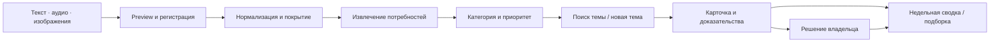

<div align="center">
  
  <p><strong>ИИ-аналитика обратной связи для поддержки и продуктовых команд</strong></p>
  <p>Обращения → потребности с доказательствами → темы → решение → отчёт</p>
  <p>
    <a href="#быстрый-запуск"><strong>Запустить локально</strong></a>
    · <a href="#что-реализовано">Возможности</a>
    · <a href="#сценарий-демонстрации">Сценарий показа</a>
    · <a href="docs/CONCEPT.md">Концепция</a>
  </p>
</div>

> Хакатонный пилот по кейсу «Газпром нефти». Демонстрация работает локально
> на синтетических данных и явно подготовленных ответах **authored replay**.
> Доступ к внутренним Qwen не предоставлен. Работа пилота не является
> измерением качества живых моделей или статистикой компании.

## Зачем нужен GPN Insight

Поддержка решает текущие проблемы, но повторяющиеся некритичные пожелания
могут теряться при передаче в продуктовую команду. GPN Insight выделяет
потребности из заявок и материалов звонков, объединяет сходные случаи
и готовит проверяемую сводку.

В одной заявке может быть несколько потребностей. У каждой сохраняются
подтверждающие цитаты, категория, объяснение приоритета и неизвестные
обстоятельства. Счётчики рассчитывает приложение по сохранённым источникам.

Агент анализирует, но не отвечает клиентам и не исправляет неполадки.
Неясные случаи остаются в аналитике без обязательной эскалации поддержке.
Решения о продуктовых изменениях принимает человек.

## Что реализовано

- Текстовый и медиаимпорт: **предпросмотр → подтверждение → повтор без дублей**.
- Проверка WAV/MP3 и PNG/JPEG, регистрация файлов и восстановление после сбоев.
- Нормализация текста и подготовка медиа через адаптеры со строгим replay.
- Частичная обработка: пригодный контекст и ошибки видны раздельно;
  retry использует успешные этапы.
- Извлечение нескольких потребностей, поиск по паспортам и предложение новых тем.
- Пять категорий и четыре приоритета с объяснением и доказательствами.
- Мониторинг тем и всех обращений, поиск, фильтры, компактный список
  и колонки по приоритетам с независимой пагинацией.
- Карточки по центру, раскрываемые исходники/расшифровки,
  просмотр синтетических изображений и аудио, ошибки и покрытие.
- Решения владельца, редактор описания темы и добровольное уточнение связей:
  проверка версии, отказ **409**, сохранение истории и ручных исправлений.
- Подборка до 30 тем/обращений с резюме и комментарием автора.
- Неизменяемый SQLite-архив, просмотр, Markdown/JSON, отдельные PDF и печать.
- Отчёт за пн–вс по Москве: автосохранение в понедельник 00:00 при работающем
  сервере; после простоя — последняя завершённая неделя.
- Светлая и тёмная темы с сохранением выбора в браузере.

Один источник может появиться в нескольких колонках приоритетов; их счётчики
нельзя складывать. Статус темы — решение о потребности, а не статус закрытия
тикета. «Недостаточно данных» не заменяется обычным приоритетом.

## Как устроен продукт



Backend — модульное приложение на **Python 3.13, FastAPI и Pydantic**.
Хранение — **SQLite через sqlite3**, интерфейс — **React, TypeScript и Vite**.
Один серверный процесс выполняет запуски последовательно; checkpoints
сохраняют успешные этапы. После рестарта прерванный запуск получает
`interrupted`, новый может использовать выполненную работу.

Целевая архитектура использует внутренние **Qwen 3.8, Qwen-ASR и Qwen-VL**.
Модель не получает произвольный доступ к файлам, БД и командам.
Внешние LLM, API и CDN при обработке не используются.
Replay воспроизводит только известные точные входы; скрытого перехода из live нет.

## Быстрый запуск

Проверенная среда: **Python 3.13.0, Node.js 24.22.2 и npm**.
Команды ниже — для PowerShell. Активация окружения и изменение политики
выполнения скриптов не нужны.

### 1. Подготовка окружения

```powershell
git clone https://github.com/anvs11/GPN_Insight.git
Set-Location GPN_Insight

python --version
python -m venv .venv
.\.venv\Scripts\python.exe -m pip install -r backend/requirements.txt
.\.venv\Scripts\python.exe -m pip check
npm --prefix frontend ci
```

Если проект и `.venv` уже существуют, используйте их: повторный клон
и создание окружения не нужны. Установка зависимостей требует доступа
к реестрам пакетов; это не модельные вызовы работающего приложения.

### 2. Backend и изолированный демонабор

В первом терминале из корня проекта:

```powershell
Set-Location backend
$demoJson = ..\.venv\Scripts\python.exe -X utf8 -m scripts.prepare_acceptance_demo
if ($LASTEXITCODE -ne 0) { throw 'Демо не подготовлено' }
$demo = $demoJson | ConvertFrom-Json
foreach ($entry in $demo.environment.PSObject.Properties) {
    Set-Item -Path "Env:$($entry.Name)" -Value $entry.Value
}

$demo.folder
$demo.selected_files
$demo.text_manifest

..\.venv\Scripts\python.exe -X utf8 -m uvicorn app.main:app --host 127.0.0.1 --port 8000 --workers 1
```

Создаётся отдельная `var/acceptance-demo-<UUID>` с SQLite, материалами
и replay-профилем. Рабочие `.env` и база не перезаписываются. Настройки
действуют в этом терминале. Набор содержит пять источников, три темы,
повторяющуюся потребность, неразобранный случай и частичное покрытие.

Проверка: [GET /api/v1/health](http://127.0.0.1:8000/api/v1/health).
Корневой адрес backend `/` не является страницей интерфейса.

### 3. Frontend

Во втором терминале из корня проекта:

```powershell
Set-Location frontend
npm run dev -- --host 127.0.0.1 --port 5173 --strictPort
```

Интерфейс: **[http://127.0.0.1:5173/](http://127.0.0.1:5173/)**.
Vite перенаправляет `/api` на локальный backend:8000.

Если ранее использовали portable Node и `npm` отсутствует в PATH:

```powershell
$taskNodePath = (Get-Content -Encoding UTF8 ..\var\tooling\node\active-path.txt -Raw).Trim()
$env:PATH = "$taskNodePath;$env:PATH"
& "$taskNodePath\npm.cmd" run dev -- --host 127.0.0.1 --port 5173 --strictPort
```

Этот вариант требует уже подготовленного `var/tooling/node`.
Для новой установки используйте установленный Node.js.
Порты 8000 и 5173 должны быть свободны. Остановка — **Ctrl+C в обоих терминалах**.

На Linux/macOS используется `.venv/bin/python` вместо `.venv\Scripts\python.exe`,
а переменные из `demo-settings.json` задаются средствами своей оболочки.
Подробности: [запуск и повторное открытие той же базы](docs/MONITORING_WORKSPACE.md).

## Сценарий демонстрации

1. Откройте **Мониторинг → Темы**, посмотрите повторяющуюся потребность.
2. В **Обращениях** сравните колонки и список, примените фильтры.
3. Откройте карточку: категория, приоритет, основание, цитата и покрытие.
   Раскройте текст/расшифровку, посмотрите вложения.
4. В **Загрузке данных** выберите напечатанный `text_manifest` либо
   `manifest.json` и файлы из `selected_files`. Выполните preview, подтвердите
   импорт и повторите: неизменные записи не добавятся повторно.
5. В разделе **Обработка** запустите анализ. Для демонабора подготовлены
   точные записи продолжения после частичной ошибки. Произвольный новый текст
   в replay может получить ошибку отсутствующей записи.
6. Сохраните решение по теме, выберите карточки через **«+ В отчёт»**.
7. В **Отчётах** добавьте резюме, сохраните подборку, откройте архивный снимок
   и скачайте документ. Последующее решение не перепишет старый отчёт.

Даты демоданных фиксированы в ноябре 2026 года. Искусственное аудио — тишина,
ответы подготовлены вручную: это показ процесса, не настоящего распознавания.
Для повторного запуска **той же** базы используйте её `demo-settings.json`;
повторная подготовка создаёт другой набор и другой архив.

## Настройки и безопасность

Названия параметров и безопасные значения — в [`.env.example`](.env.example).
Настоящие адреса, model ID и ключи моделей не предоставлены; вымышленные
значения не делают live готовым. Без согласованного профиля запуск анализа
возвращает явную ошибку интеграции.

- Пилот принимает синтетические наборы. Нельзя ставить `synthetic=true`
  реальным данным для обхода ограничений.
- Входное хранилище по условию уже обезличено. Корпоративная авторизация,
  доступ к оригиналам и промышленная приёмка требуют отдельной интеграции.
- `.env`, SQLite, uploads и результаты в `var/` не включаются в Git.
- `APP_WEEKLY_ARCHIVE_ENABLED=false` отключает автосохранение недели;
  ручная кнопка остаётся. Проверка расписания — каждые 30 секунд, рассылки нет.
- PDF создаётся локально через Pillow и кириллический системный шрифт.
  Он растровый, до 30 страниц; текстовый поиск доступен в Markdown/JSON.
  Отсутствие шрифта или превышение лимита даёт явную ошибку.

## Проверка проекта

Из `backend/`:

```powershell
..\.venv\Scripts\python.exe -X utf8 -m pytest -q
..\.venv\Scripts\python.exe -m pip check
..\.venv\Scripts\python.exe -X utf8 -m scripts.check_workspace_contracts
..\.venv\Scripts\python.exe -X utf8 -m scripts.check_frontend_media_http --workspace
```

Из `frontend/`:

```powershell
npm run test -- --run
npm run lint
npm run build
```

HTTP-проверка использует отдельный backend и действия React/jsdom через
настоящие HTTP/SQLite, включая рестарт. Это не визуальная приёмка браузера
и не измерение качества модели. На Windows symlink-тесты могут быть пропущены,
если нет системного права создания ссылок.

## Структура репозитория

```text
.
├── backend/
│   ├── app/             API, SQLite, pipeline, адаптеры и replay
│   ├── prompts/         Версионируемые инструкции модели
│   ├── scripts/         Подготовка демо и сквозные проверки
│   └── tests/           Backend-тесты
├── frontend/            React/TypeScript/Vite и UI-тесты
├── data/                Синтетические наборы, контракты и recordings
├── docs/                Концепция, интерфейсы и приёмка
├── .agent/              План реализации и история решений
└── var/                 Локальные базы, файлы и отчёты проверок — вне Git
```

## Документация

- [Концепция и границы продукта](docs/CONCEPT.md)
- [Мониторинг, отчёты и команды показа](docs/MONITORING_WORKSPACE.md)
- [Представления интерфейса](frontend/README.md)
- [Импорт и ограничения файлов](docs/IMPORT_HTTP.md)
- [Хранение и транзакции](docs/STORAGE.md)
- [Pipeline и checkpoints](docs/PIPELINE.md)
- [Частичная обработка и медиа](docs/PARTIAL_WEEKLY_HANDOFF.md)
- [Итоговая приёмка](docs/FINAL_ACCEPTANCE.md)
- [Методика экономического эффекта](docs/EFFECT.md)
- [Общий ExecPlan](.agent/EXECPLAN.md)

Материалы конкурсной подачи готовятся отдельно от инженерной документации.
## Что ещё требует проверки и интеграции

Для корпоративного внедрения нужны настоящие внутренние модели, независимая
оценка качества, пользовательский хронометраж, права и автоматическая доставка.
Текущий продукт — «Вебнефть»; распределение по продуктам и объединение
звонка/заявки в уникальный инцидент не объявляются реализованными.
Производительность на 400–480 обращениях в день требует нагрузочного испытания.
Денежный эффект — расчётный сценарий, не полученная экономия.

---

<div align="center">
  <strong>Команда GPN Insight · Intelligence CUP · кейс «Газпром нефти»</strong>
</div>
