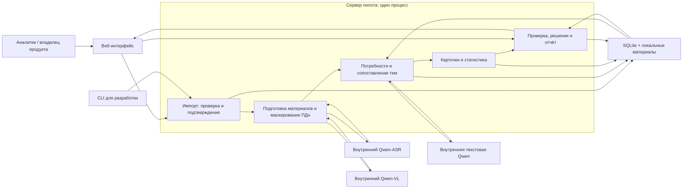
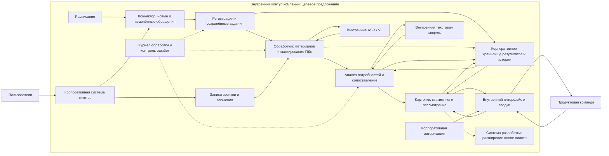

# GPN Insight — анализ продуктовой обратной связи

Независимый серверный срез 2026-11-07: добавлены фильтры тем/отдельная статистика периода, HTTP ручного паспорта с версиями/историей и полный текстовый сценарный authored record/verify. 587 tests и настоящий HTTP/CLI/restart подтверждают сохранность решений, manual passport, distinct-счётчики и воспроизводимость потока с merge/exclude. UI, live-модели, медиа, независимое качество и готовность всей демонстрации остаются отдельными интеграциями; продуктовые границы и методика эффекта не менялись. Текущие контракты — docs/SERVER_COMPLETION.md, прежние этапные статусы ниже исторические.

Дополнение 2026-11-07 после согласования с участником 2: первая тема при пустом каталоге теперь создаётся через тот же проверенный proposal-путь. Review/ошибка не дают автоматической карточки. Текстовый cold-start/new→match/решение/повтор/restart проверен на явно synthetic/authored replay и отдельной SQLite; 541 backend tests прошли. Это инфраструктурная приёмка, без измерения live-качества. Прежние замечания о незавершённом cold-start ниже являются историческими.

Актуализация серверной интеграции 2026-11-07: после PR #10 в непустом каталоге работает путь полного поиска → ProposedTopic → сохранённая тема, затем присоединение нового обращения с сохранением решения. U3 проверил его через обычный Uvicorn и строгое synthetic/authored replay, включая рестарт. Это подтверждение процесса, не качества или доступности live-модели. Первая тема при пустом каталоге остаётся отдельной доработкой U2 (сейчас review); продуктовые границы не менялись. Текущие ограничения и результаты — docs/TEAM_INTEGRATION.md; прежние этапные записи ниже являются историческими.

Ручной серверный срез 2026-11-07: реализованы resolve assignment review, полный PATCH немерженных бизнес-статусов, подтверждаемое объединение тем, исключение неверной связи с review/override и Markdown-сводка из SQLite. 515 backend-тестов и настоящий HTTP/CLI/restart подтвердили версии/повторы/rollback/сохранность решений и счётчиков. Это серверные действия; UI новых операций ещё за U4, auto-new/полный поиск/живые модели/эталон качества ещё за интеграцией команды. Подробности — docs/HUMAN_WORKFLOW.md; исторические статусы предыдущих этапов ниже не отменяют этот результат.

Фактическое состояние общей интеграции 2026-11-06: в отдельной проверочной сборке подключены текстовый импорт/Normalizer U1 и AnalysisService U2 по явному профилю и строгому replay; frontend U4 читает темы/источники и сохраняет решения. Добавлены серверный ProposedTopic и чтение review. Проверены 478 backend-тестов и настоящие HTTP/restart с authored-происхождением. Live Qwen, auto-new/полный поиск U2, размеченный holdout, UI импорта/review и медиа не объявляются готовыми. Описания первоначальных этапов ниже исторические; текущее состояние и границы — docs/TEAM_INTEGRATION.md.

Фактическое подключение по профилю (2026-11-06): глобальный app.main:app может собрать готовые TextNormalizer/AnalysisService/ReplayGateway при явном совпадающем серверном профиле и наборе. В этой сессии реальные настройки отложены пользователем; рабочая установка не включалась фиктивными ID. Обычный сервер без injection проверен на изолированном synthetic/authored replay, с сохранением ошибок/решений/checkpoints и явной live неготовностью; 459 тестов. Подробности — [RUNTIME_PROFILE.md](RUNTIME_PROFILE.md).

HTTP/CLI-срез U1 (2026-11-06): общий импорт доступен через POST/GET imports и CLI без моделей. Preview не пишет, commit повторно валидирует текущий набор, неизвестные files/media отклоняются целиком, фактический body ограничивается до multipart. Реальные HTTP/CLI/repeat/delta/guard/restart пройдены на отдельной synthetic SQLite; решения/история сохраняются, анализ без конфигурации честно INTEGRATION_NOT_READY. Контракты/передача участнику 4 — [IMPORT_HTTP.md](IMPORT_HTTP.md). Форма и медиа остаются отдельной работой.

Фактическая текстовая адаптация U1 к PR #7 (2026-11-06): готовы Python import commit, masking/Normalizer и явная сборка с настоящим AnalysisService/существующим Pipeline/API. На synthetic/authored replay пройден маршрут импорт → обработка → match → источник → решение → повтор/delta/reopen; 369 тестов. Cold-start возвращает review, автоматического new у U2 ещё нет. HTTP-загрузка/медиа/live и автоматическая конфигурация глобального main не добавлены. Проверенные ограничения и команды — [TEXT_INTEGRATION.md](TEXT_INTEGRATION.md).

## Концепция

GPN Insight — внутренний ИИ-сервис, который находит повторяющиеся потребности в обращениях пользователей и доводит их до решения продуктовой команды. Владелец продукта видит понятную карточку: что пользователи пытаются сделать, что им мешает, насколько часто это повторяется и какие обращения подтверждают вывод.

Результат — постоянная тема с доказательствами, ответственным и историей решений. Сотрудники поддержки продолжают привычную работу; дополнительная ручная разметка каждого тикета не требуется. Проверку спорных групп выполняет назначенный аналитик или представитель продуктовой команды.

Редакция 4, 2026-11-04. Документы согласованы для начала реализации; это описание будущего пилота, а не готового приложения.

Основа backend на 2026-11-04: каркас FastAPI на проверенном Python 3.13.0, общие контракты и SQLite-путь с отдельно загружаемой синтетической карточкой и источниками. Полный сценарий, импорт, модели, группировка, настоящий replay и frontend ещё не реализованы. Тестовая карточка помечена authored, analysis_mode=null; выбранный режим replay не выдаётся за успешное воспроизведение. Последующие этапы хранения и минимального HTTP описаны ниже; команды и передача контрактов участникам находятся в README.md.

После этапа хранения добавлен SQLite v2: версии источников и материалов, нормализация/потребности, темы/связи, решения/история, review/ручные переопределения, записи запусков и завершённые регистрации. Это расширение хранения, а не реализация импорта, pipeline, review-политики или моделей. Старые данные переносятся с резервной копией без сброса; интерфейс регистрации и граница с файловым протоколом участника 1 описаны в docs/STORAGE.md.

Минимальный HTTP-этап участника 3: API читает сохранённые темы/карточки/источники, принимает new/needs_research с обязательными owner/reason/version и историей. Возврат в new — явное решение человека, сохраняющее прежние события; автоматического сброса решений нет. Обычный старт оставляет пустую базу пустой, synthetic/authored-фикстура загружается отдельной процедурой. Команды участника 4 — в docs/API_HANDOFF.md. Остальные статусы, фильтры, импорт и полный браузерный сценарий остаются целевыми до отдельной реализации.

Хакатонный пилот рассчитан на четырёх участников и девятидневный цикл разработки. Он охватывает один продукт — «Вебнефть», одну продуктовую команду, текст, короткие звонки и скриншоты. Дни считаются от старта реализации, а не от даты редакции документа. Название GPN Insight рабочее; оно относится к кейсу «Газпром нефти».

Участник 1, U1-01 на 2026-11-05: реализована строгая проверка текстового manifest и Python-preview без записи, с предварительными counts через read-only SQLite v2. Есть четыре синтетических текстовых примера; общий алгоритм хеша переиспользуется регистрацией. Фиксация импорта через этот сервис, HTTP/CLI-загрузка, маскирование, нормализация и медиа ещё не подключены. Это частичный результат подготовки импорта, а не готовый пользовательский путь; команды и ограничения — в README.

Срез участника 4, слитый через PR #6 на 2026-11-05: локальная панель Frontend показывает состояние production API, режим и незавершённую интеграцию, обрабатывает ошибки и читает сохранённый запуск по ID. На том этапе карточка была явно статичным макетом; чтение настоящей карточки/источников, сохранение решения и весь сквозной путь ещё не были подключены. Пройдены 17 тестов, lint/build и HTTP-проверки. При подготовке первого коммита пользователь сообщил о ручной визуальной проверке интерфейса без замечаний; автоматическая проверка браузера не выполнялась. Команды и сценарий — frontend/README.md; первый этап целиком не объявлялся завершённым.

Следующий ограниченный шаг участника 4: статичный макет заменён реальным списком сохранённых тем GET /topics, доступным независимо от готовности анализа. Список различает загрузку/пустой ответ/ошибку, сохраняет последний результат с предупреждением при отказе обновления, показывает серверные счётчики и происхождение данных без подмены отсутствующих заявителей нулём. Пройдены 28 тестов, lint/build и настоящий HTTP списка с проверкой сохранности решения; затем пользователь подтвердил ручную визуальную приёмку списка без замечаний.

Предыдущий небольшой шаг участника 4: по нажатию на тему подключены GET /topics/{topic_id} и GET /sources/{source_id}. Карточка показывает паспорт, серверные показатели, статус, версии, цитаты и историю; источник — текущую версию, фрагменты и ошибки. Отсутствие обработки не трактуется как отсутствие потребности, синтетика и режимы видны, ошибки не очищают список и настройки. При обновлении/отказе источника сверка цитаты не подтверждается по старым данным. На этом срезе пройдены 52 теста Frontend, lint/build и настоящий HTTP; PATCH оставался следующим шагом.

Текущий шаг участника 4, 2026-11-06: форма сохраняет только new/needs_research через существующий PATCH /topics/{topic_id}/decision с owner/reason/version. Повторное чтение проверяет статус, версию, новое событие и неизменность прежней истории до подтверждения. 409 требует проверки и явного принятия актуальной версии; ошибки сохраняют черновик, неопределённый ответ проверяется GET без слепого повтора записи. Более позднее решение другой вкладки показывается отдельно. Заключительный аудит: 84 теста Frontend, lint/TypeScript/build, 194 теста Backend с одним прежним предупреждением и настоящий HTTP/SQLite/рестарт на синтетике прошли. Проверены одновременные PATCH одной версии: один успех и один 409 без потери истории. Исправлены два случая отката интерфейса запоздалыми GET и показ прежнего подтверждения при обновлении/смене версии. Ручная визуальная приёмка всего второго этапа подтверждена пользователем без замечаний; последние исправления проверены автоматическими регрессиями, автоматический браузерный проход не заявляется. Исходники Backend, общий ExecPlan, данные и зависимости не менялись. Импорт, медиа и полный Pipeline не подключались; новый код анализа из main 2afa4311 не выдаётся за работающий ИИ-сценарий. Весь первый этап не закрыт.

## Реализуемый пилот и целевое внедрение

Этап запусков участника 3 (2026-11-05): добавлены последовательный worker, POST/GET runs, SQLite v3 со снимками входов и checkpoints, interrupted при рестарте, общий guard фиксации импорта и строгий текстовый replay. Двухпроходная инфраструктура проверена только синтетическими тестовыми компонентами; нормализация участника 1 и анализ участника 2 ещё не подключены. Production POST честно возвращает INTEGRATION_NOT_READY. Начальный record/verify проверяет точные текстовые артефакты и provenance; это не готовый live-анализ, полный сценарий качества или измерение моделей. Команды и контракты — docs/PIPELINE.md.

| Область | Реализуем в пилоте | Предлагаем для промышленного внедрения |
|---|---|---|
| Поступление данных | Загрузка через браузер: один JSON и связанные WAV/MP3, PNG/JPEG; CLI для разработки и проверок | Коннектор к корпоративной системе тикетов: новые и изменённые обращения, ссылки на звонки и вложения |
| Обработка | Запуск по кнопке, один серверный процесс с последовательной обработкой | Периодический инкрементальный запуск, отдельные обработчики при подтверждённой нагрузке |
| Модели | Адаптеры к доступным внутренним моделям; явно обозначенный replay при отсутствии доступа | Внутренние текстовая модель, ASR и VL через согласованные интерфейсы |
| Хранение и доступ | SQLite, локальные синтетические/разрешённые данные, один тестовый владелец | Корпоративная БД и разрешённое хранение материалов, авторизация и доступ по продуктам |
| Результат | Карточки, очередь проверки, решения, сводка, ручная ссылка на задачу | Внутренний портал, согласованный канал уведомлений; интеграция с разработкой отдельным расширением |

Корпоративный API, права и фактический протокол моделей пока не подтверждены. Промышленная схема — проектное предложение, не заявление об уже существующей интеграции. Загрузка через браузер входит в согласованный пилот; автоматическое получение обращений — в целевое внедрение.

## Архитектура пилота

Пять логических компонентов реализуются в одном серверном приложении. Веб-интерфейс отделён от серверной обработки. Диаграмма показывает проектируемый пилот; сам код ещё предстоит реализовать.

Если внутренние модели недоступны, соответствующие адаптеры могут работать в режиме replay: воспроизводить сохранённые ответы для известных входов. Режим постоянно виден в интерфейсе и отчёте. Каждая запись имеет происхождение: model — записана реальным вызовом модели, authored — составлена командой; признак виден в интерфейсе и отчёте, а записи authored не называются ответами модели. Незаметной подмены настоящего вызова сохранённым ответом нет; replay не доказывает качество живых моделей.

1. **Data Import — получение обращений.** В браузере аналитик выбирает JSON-выгрузку и связанные файлы и сначала видит проверку без записи (dry run); кнопка «Импортировать» повторно проверяет набор и возвращает фактические счётчики. Предварительные счётчики могут измениться, если изменились данные. Записи базы фиксируются одной транзакцией; временные файлы и восстановление после сбоя обрабатываются отдельно. Между проверкой и подтверждением сервер не хранит пользовательскую сессию загрузки. Тип файлов проверяется по содержимому, имена и лимиты — по правилам загрузки. CLI использует тот же механизм. Повторы не создают дубли. Поддержка произвольных таблиц, архивов и документов не входит в объём.
2. **Multimodal Normalizer — подготовка материалов.** Получает текст, расшифровку через ASR и сведения из изображения через VL. До сохранения и до любых вызовов текстовой модели маскирует очевидные персональные и платёжные данные (телефоны, адреса электронной почты, номера карт, ИНН, счета) в тексте, расшифровке и описании изображения; простые правила не гарантируют полноту. Сохраняет происхождение фрагментов; показывает ошибки. Временные метки звонка используются только при их наличии в ответе модели.
3. **Needs Analysis & Grouping — анализ и сопоставление.** Выделяет одну или несколько потребностей, различает ошибки, вопросы, операционные просьбы и пожелания. Возвращает один из трёх исходов: существующая тема, ручная проверка, новая тема-кандидат. Сначала проверяет наиболее близкие паспорта, а при отсутствии совпадения — оставшиеся небольшими порциями. Новую тему создаёт только после полного поиска; если лимит вызовов исчерпан, направляет потребность на проверку. Обработка идёт в стабильном порядке, чтобы запуски воспроизводились.
4. **Evidence Cards — карточки и статистика.** Формирует описание и доказательства; отдельно отмечает гипотезу улучшения. Числа рассчитываются программно по уникальным идентификаторам обращений. Новые свидетельства обновляют существующую тему с постоянным идентификатором.
5. **Product Review — рассмотрение.** Показывает карточки и спорные сопоставления, сохраняет ответственного, решение и комментарий. Позволяет исправить группу, объединить темы, отложить рассмотрение, отметить реализацию и подготовить сводку.

## Целевая промышленная архитектура

Предлагаемый основной способ получения данных — разрешённый API системы тикетов. Если его нет, с кейсодателем согласуется другой интерфейс чтения или регламентная выгрузка. Прямой доступ к рабочей БД и конкретное название корпоративной системы не предполагаются.

Разделение сервисов обосновывается их обязанностями: коннектор изолирует особенности корпоративной системы; обработчик материалов — длительные ASR/VL-вызовы и их повторы; анализ — правила и версии промптов; сервис рассмотрения — права, решения и выдачу результатов. Регистрация заданий хранит состояние и позволяет повторить неудачный этап. Текстовая модель не получает прямого доступа к корпоративным системам.

Для целевого решения нужно согласовать постоянные идентификаторы, получение обновлений, правила хранения и удаления материалов, права на просмотр источников. Интерфейс не должен раскрывать источник сотруднику, у которого нет соответствующих прав. Повторы получения данных не увеличивают статистику; ошибки и отставание обработки наблюдаемы. Пунктир к системе разработки — возможная последующая интеграция, не функция пилота.

Целевое решение также требует правил маскирования и хранения персональных данных, прав на оригиналы звонков и скриншотов и журнала доступа к источникам. Пилот реализует лишь простое маскирование на синтетических данных и не заменяет эти решения.

## Как потребность относится к теме

У темы есть **паспорт**: продукт, пользовательский сценарий, конкретная потребность или затруднение, существенные условия, подтверждающие примеры и границы — какие похожие случаи сюда не относятся. Заголовок служит названием, а не ключом идентичности. Первоначальные границы, предложенные моделью, помечены как неподтверждённые до проверки человеком; первопричины по одним симптомам не придумываются.

Пример: «Изменение контактного номера в оформленной заявке». Сюда относятся просьбы заменить контакт именно в созданной заявке. Смена номера для входа и недоставка СМС — другие сценарии. Общего слова «телефон» недостаточно для объединения.

| Исход | Когда используется | Что происходит |
|---|---|---|
| Существующая тема — match | Найдена одна подходящая тема по сценарию и потребности, нет существенного противоречия | Добавляются доказательства и обновляются программные счётчики |
| Ручная проверка — review | Мало контекста, несколько подходящих тем, противоречие либо поиск не завершён в установленный лимит | Аналитик видит причины и источники; выбирает тему, создаёт новую или отмечает недостаточность данных |
| Новая тема-кандидат — new | Потребность понятна и подтверждена; все действующие паспорта продукта проверены, подходящей темы нет | Создаётся постоянная тема с одним или несколькими свидетельствами |

Паспорта передаются в компактной форме с сохранением сценария, сути и существенных границ. Их допустимый размер проверяется в день 1. При большом числе тем сервер сначала берёт лексически ближайшие, затем, если совпадения нет, проверяет оставшиеся порциями. Лексический поиск задаёт порядок, но не доказывает отсутствие смыслового совпадения. candidate_set_complete выставляет только сервер после успешной проверки всего набора. При неполном поиске автоматический new запрещён; увеличение числа тем само по себе не должно останавливать анализ. Лимит вызовов остаётся защитой от долгой обработки, а случаи его исчерпания считаются отдельно.

При ясном match в одной из порций можно закончить поиск раньше: это модельное предположение, его точность измеряется отдельно. Если модель сама отмечает сомнение, оно не превращается в match. Сетевой сбой или ошибка ответа — ошибка этапа, а не новизна потребности. Неудача чтения материала также не означает отсутствия запроса.

Сначала потребности извлекаются из всех обращений, затем сопоставляются в стабильном порядке даты создания и source_id. Это обеспечивает повторяемость процесса, но не гарантирует одинаковую группировку при другом порядке. В день 6 выполняются отдельные прогоны с действительно изменённым порядком сопоставления на пустых базах; сравниваются составы тем по потребностям, а не их идентификаторы.

Кандидат с одним обращением доступен отдельным фильтром. Повторяющейся тема становится при минимум двух разных source_id, что не означает двух разных клиентов. Пока спорная потребность не распределена человеком, она не увеличивает счётчик предполагаемой темы. Ручные решения сохраняются при повторной обработке неизменившегося источника. Назначенный аналитик или представитель продукта проверяет спорные случаи; нагрузка на эту очередь измеряется вместе с качеством автоматических назначений.

**Исправления входят в ядро.** Человек может убрать неверное назначение в очередь проверки и объединить две темы с сохранением истории. Предложения дубликатов от модели — дополнительная функция после готовности ядра. Она может использовать лексически близкие паспорта, но не гарантирует нахождения всех перефразировок и не заменяет полный поиск перед new. Решение «оставить раздельно» запоминается для тех же версий паспортов.

## Жизненный цикл темы

Тема не удаляется после решения: её паспорт используется для сопоставления будущих обращений. Состояние рассмотрения и повторяемость потребности — разные признаки. Тема с одним обращением тоже может получить решение.

| Состояние | Обязательные сведения | Новые обращения |
|---|---|---|
| Новая | Паспорт и источники; при создании ответственный ещё не назначен, при явном возврате сохраняются владелец и причина | Добавляются в ту же тему; прежняя история рассмотрения сохраняется |
| Исследуется | Ответственный и комментарий | Пополняют доказательства |
| Передана в разработку | Ответственный, комментарий, ссылка/идентификатор задачи | Обновляют тему без создания дублей задач |
| Отложена | Ответственный, причина, дата пересмотра | Накапливаются; в дату пересмотра тема появляется в списке «Пора пересмотреть» |
| Отклонена | Ответственный и бизнес-причина | Учитываются; изменение спроса видно по новым обращениям после решения |
| Реализована | Ответственный, комментарий о результате, дата внедрения | Обращения, созданные после даты внедрения, отмечаются для проверки результата |
| Объединена | Основная тема, автор и причина объединения | Направляются в основную тему; старая карточка сохраняет историю и ссылку |

В пилоте решения и факт реализации отмечает человек. Ссылка на задачу не подтверждает, что изменение уже внедрено. Повторы после даты внедрения — повод проверить результат, а не автоматическое доказательство регрессии. Владелец может вернуть тему на исследование с комментарием; модель самостоятельно не отменяет решение.

Для отложенных тем достаточно списка по дате. Для отклонённых и реализованных показывается количество новых обращений после решения/внедрения; пороги автоматического возврата по росту спроса не вводятся без согласования. Новая загрузка старого обращения не считается новым спросом после внедрения. При объединении статистика пересчитывается по уникальным обращениям, история обеих тем сохраняется. Бизнес-отказ и ошибка анализа учитываются отдельно. Автоматического дообучения модели на этих действиях нет.

## Tools — инструменты обработки

Это ограниченные операции приложения. Последовательностью управляет сервер; модель не получает произвольного доступа к файлам и корпоративным системам.

- import_tickets(manifest, assets, dry_run) — при dry_run проверить выгрузку без записи, иначе повторно проверить и зарегистрировать набор с восстановлением после сбоя; используется веб-интерфейсом и CLI.
- normalize_ticket(ticket) — подготовить доступные материалы и происхождение фрагментов.
- mask_pii(text) — заменить очевидные персональные и платёжные данные до анализа и сохранения.
- transcribe_audio(asset) — получить расшифровку через внутреннюю ASR-модель.
- describe_image(asset) — извлечь относящиеся к обращению сведения из изображения.
- extract_needs(document) — выделить потребности и доказательства.
- assign_topic(need, topic_passports) — вернуть существующую тему, ручную проверку или нового кандидата.
- find_duplicate_topics(run_id) — дополнительная функция: предложить человеку возможные дубликаты; не является защитой, разрешающей new при неполном поиске.
- resolve_review(review_id, resolution) — сохранить решение человека по спорному сопоставлению.
- calculate_topic_stats(topic_id, period) — вычислить частоту, динамику и обращения после решения.
- build_evidence_card(topic_id) — сформировать карточку с источниками и ограничениями.
- get_source(source_id) — открыть разрешённый источник.
- record_decision(topic_id, decision) — сохранить состояние, ответственного и историю решения.
- record_feedback(topic_id, feedback) — зарегистрировать ошибку анализа отдельно от бизнес-решения.
- merge_topics(source_topic_id, target_topic_id) — объединить темы с сохранением истории.
- exclude_needs(topic_id, need_ids) — обязательная операция исправления неверного назначения: убрать связь, пересчитать числа и направить потребность на review. Отдельный массовый экран необязателен.
- list_topics_due_for_review(as_of) — показать отложенные темы с наступившей датой пересмотра.
- build_report(product_id, period) — подготовить сводку по темам, проверкам и решениям.

Модель вызывается только внутри extract_needs, assign_topic, find_duplicate_topics и адаптеров ASR/VL; остальное — операции приложения и действия человека. Автономность модели ограничена намеренно: порядок задаёт сервер, результат проверяется схемой и серверными правилами. Расширение автономности, например самостоятельный запрос недостающих источников, относится к целевому внедрению.

## Преимущества и сравнение вариантов

- Показывает полный путь от самостоятельной загрузки в браузере до решения владельца и последующего обновления темы.
- Сопоставляет разные формулировки одной потребности и позволяет проверить, не объединены ли разные проблемы по общим словам.
- Сохраняет источники, историю, ручные исправления и решения.
- Обрабатывает текст, звонки и изображения в явно поддерживаемых пределах.
- Имеет отдельный маршрут для сомнений; поддержка не получает новую обязанность проверять каждый тикет.
- Позволяет честно показать реализованный пилот и путь промышленного внедрения.

Относительно Basic добавлены медиа, веб-загрузка, проверка сопоставлений и постоянный цикл работы с темой. Относительно Pro сохранены нужные каналы и проверка человеком без обязательных real-time-интеграций. Относительно Agent реализуется предсказуемый процесс с историей, без отдельной автономной оркестрации и аналитического чата. Из видео взят подход с кратким результатом и разбором ошибок; продажи, контроль сотрудников и клиентский бот в продукт не переносятся.

Это преимущества по соответствию задаче и демонстрируемым возможностям. Качество, скорость и стоимость нужно измерить; превосходство над чужими реализациями заранее не заявляется.

## End-to-end сценарий

1. Аналитик открывает страницу импорта, выбирает JSON и связанные звонки/скриншоты, видит предварительную проверку и подтверждает загрузку. Некорректная структура не меняет данные.
2. Запускает анализ. Интерфейс показывает режим live/replay, прогресс и ошибки материалов.
3. Из разных формулировок, звонка и скриншота выделяется потребность менять контакт в оформленной заявке. Если подходящей темы ещё нет, сохраняется кандидат; повторные свидетельства делают тему повторяющейся.
4. В карточке видны число обращений, динамика и источники. Возможность контролируемого изменения контакта показывается как гипотеза улучшения, а не доказанный факт отсутствия функции.
5. Отдельное обращение «Поменяйте номер, не могу войти» попадает в очередь проверки. Аналитик уточняет назначение по источнику; без достаточного контекста не присоединяет его к теме заявки.
6. Владелец проверяет карточку и выбирает «Исследуется» либо передаёт её в разработку со ссылкой на задачу. Если откладывает — указывает причину и дату пересмотра.
7. Аналитик повторно загружает тот же набор через браузер. Обращения, темы и решения не дублируются.
8. Добавляет новое обращение по известной потребности: обновляется прежняя карточка, решение сохраняется, в сводке видны новые свидетельства.
9. Владелец демонстрирует отметку реализации. Новое обращение с датой создания после внедрения получает отметку для проверки результата, но не открывает задачу автоматически. Старое обращение, импортированное позднее, такой сигнал не создаёт.
10. На отдельном примере показывает ручное объединение двух тем и дату пересмотра отложенной. Автоматическое предложение дубля показывается только при реализации дополнительной функции. Повреждённая копия файла даёт понятную ошибку; остальные материалы обрабатываются.

Основной короткий показ охватывает шаги 1–4 и 6–8. Спорное сопоставление, отложенную тему и повтор после реализации показывают подготовленными дополнительными примерами. Все искусственные примеры подписаны и не выдаются за статистику компании.

## Работа четырёх участников

| Участник | Основная зона | Проверяемый результат |
|---|---|---|
| 1 — данные, импорт и эффект | JSON/медиа, общий импорт для браузера и CLI, маскирование, адаптеры ASR/VL, docs/EFFECT.md | Загрузка без дублей, источники и ошибки; методика с источниками параметров |
| 2 — анализ и качество | Паспорта, компактный поиск порциями, match/review/new, промпты, правила разрешения review, оценка | Сопоставление с объяснением, контроль ложных new, независимый отчёт и проверка порядка |
| 3 — сервер и целостность | Контракты, БД, запуски, жизненный цикл, merge и исправления, статистика, отчёт, record/verify-recordings | Сохранность решений и истории, достоверные числа, воспроизводимый демо-набор |
| 4 — интерфейс и защита | Импорт, карточки/источники, review, решения и сводка, обе архитектурные схемы, маршрут показа | Полный сценарий в браузере и понятное представление результата |

Обе схемы оформляет участник 4; участник 3 проверяет точность. Участник 1 владеет ручками импорта, участник 3 — общими схемами данных и остальными ручками; HTTP-контракт согласуют до реализации. Участники 1 и 2 перекрёстно проверяют разметку. Каждый пишет проверки своего блока. Повседневные решения и протоколы уточняются командой без повторного согласования самой концепции. Показ результата и сверка препятствий проходят ежедневно.

## План на девять дней

| День | Общий проверяемый результат |
|---|---|
| 1 | Контракты, скелет сервера/интерфейса, четыре текстовых примера, проверка моделей и размера запроса, черновики двух схем и вопросы организаторам |
| 2 | Первый текстовый путь до решения; рабочий dry_run и импорт на сервере, черновая веб-форма; первые паспорта и три исхода; каркас EFFECT.md |
| 3 | Полный текстовый сценарий через браузер: импорт, поиск порциями, review, повтор без дублей; основной набор и сценарии заморожены; базовый жизненный цикл и текстовый replay уже работают |
| 4 | Медиа в том же сценарии; все поля решений, deferred/implemented, даты и сигналы; начало merge и записи полного демо-набора |
| 5 | Завершение merge и исправления ошибочного назначения, сводка, проверка восстановления файлов и БД; полный record → verify-recordings; репетиция измерения пользы |
| 6 | Независимое качество, прогоны с разным порядком, превышение лимита паспортов, безопасность, отказы и восстановление; новые функции не добавляются |
| 7 | Исправления, чистая сборка, проверенные схемы; измерение пользы, допустимые расчёты эффекта и презентация |
| 8 | Заморозка версии и цифр, две репетиции и резервное видео |
| 9 | Резерв, оборудование и защита |

CLI на второй день допустим как промежуточный инструмент. Веб-импорт, review и сохранение решений обязательны к завершению текстового пути дня 3. Жизненный цикл начинается в дни 2–3, а не целиком в день 5.

При отставании убираются в порядке: график и шаблон задачи; автоматические предложения дублей; отдельный массовый экран exclude; дополнительные проверки версий на второстепенных операциях. Исправление одной неверной связи через подтверждённое действие в карточке, ручной merge и защита от потери решений остаются. Из ядра не исключаются полный поиск перед new, источники, счётчики, браузерный сценарий, обязательные состояния и сигналы, проверки загрузки и маркировка replay. Сокращения отмечаются в плане, приёмке и презентации. Новые функции после дня 5 не планируются.

## Оценка эффекта

Отдельный docs/EFFECT.md нужен для обоснования пользы и расчётного приложения к защите. Он разделяет ускорение анализа и потенциальное снижение повторных обращений после внедрения улучшений. Это разные механизмы с разными доказательствами.

Высвободившиеся часы, их стоимостной эквивалент и фактическая денежная экономия показываются отдельно. Дополнительная полезная работа не считается сокращением выплат. Прогноз улучшений взвешивается по объёму обращений, а не по количеству тем; исключаются двойной учёт тикетов и одних трудозатрат. Для каждого параметра указан источник либо объяснимое допущение.

Команда проводит малый эксперимент с сопоставимым качеством ручного результата и карточек, готовит три условных сценария и чувствительность. Трёхлетняя граница инвестиций рассчитывается по денежным выгодам каждого года с учётом постепенного запуска; без оснований для денежного эффекта она остаётся неподтверждённой. Реальные объёмы, трудозатраты и цены пока неизвестны. Расчёт не объявляется доказанной окупаемостью и не заменяет отдельный конкурсный файл метрик качества.

## Приёмка и ограничения

Пилот должен без ручного редактирования базы пройти путь от веб-загрузки до обновления той же темы с сохранённым решением; показать три исхода сопоставления, отложенную тему, объединение и обращения после реализации. Числа воспроизводимы, выводы имеют источники, ошибки не скрыты. Качество проверяется отдельно на размеченной выборке; одних красивых карточек недостаточно.

Реальная интеграция с корпоративной системой, промышленная авторизация и правила хранения материалов остаются целевым внедрением. Частота обращений не равна числу клиентов или бизнес-приоритету. Продуктовая команда должна выделить владельца и время рассмотрения. Replay доказывает работу процесса, а не живой ИИ-интеграции. Окупаемость и производительность пока не подтверждены.

Маскирование простыми правилами не гарантирует полноту и не ловит имена и адреса в свободной форме; оригиналы медиа в пилоте — только синтетические. Записи replay с признаком authored не доказывают работу модели. Проверка на 100 синтетических обращениях использует принудительно уменьшенный размер порции паспортов: лимит действительно превышается, проверяется поиск по остатку и запрет new при незавершённом поиске. Это не измерение промышленной нагрузки. Проверки безопасности снижают риск, но не доказывают безопасность.

## Вопросы организаторам и кейсодателям

1. Будут ли обезличенные тексты, звонки и вложения? Если нет, допустим ли показ на синтетических данных?
2. Дадут ли доступ к внутренним моделям; какие протоколы и лимиты? Какие модели разрешены для прототипа, если доступа не будет?
3. Как можно получать данные из системы тикетов: API, выгрузка или иной согласованный способ? Доступны ли идентификаторы, даты обновлений, заявителей и ссылки на материалы?
4. Кто сейчас рассматривает повторяющиеся пожелания, принимает решения и пересматривает отложенные темы?
5. Можно ли получить два-три примера полезных пожеланий, которые сейчас теряются, и способ подтвердить, что продукт изменился?
6. Что комиссия ожидает от работающего прототипа и насколько подробно должна быть обоснована целевая промышленная архитектура?
7. Каков объём обращений по продукту и в целом по контуру, какая доля повторяется, сколько минут уходит на обработку одного обращения?
8. Кто и как часто выгружает и анализирует обращения, сколько суммарных часов в месяц это занимает отдельно от работы с тикетами? Каковы цены часа разных ролей и есть ли механизм денежной экономии? Допустимо ли в оценке эффекта считать снижение трудозатрат?
9. Какие данные допустимо хранить и показывать (госномера, телефоны, имена), нужно ли маскирование, разрешены ли оригиналы звонков и скриншотов?
10. Допустимо ли для демонстрации использовать записи ответов моделей, составленные командой, если живой доступ получить не удастся?

Ответы пока не получены. Они уточняют проект, но не заменяются выдуманными интеграциями или данными.

## История редакций

2026-11-04, слой хранения участника 3: отмечена реализация SQLite v2 и транзакционной регистрации метаданных. Файловый протокол, модели и задачи других участников не добавлялись; продуктовый объём пилота не менялся.

2026-11-04, этап 1 участника 3: добавлена отметка фактически реализованной основы backend и проверенного Python 3.13.0. Границы всего пилота сохранены; наличие схем для будущих операций не означает их реализации.

2026-11-04, редакция 2: согласованы две архитектуры, веб-импорт, паспорта и три исхода, жизненный цикл.

2026-11-04, редакция 3: товарищами предложены dry_run без сессии загрузки, лексический подбор, запись replay, защита данных и отдельная методика эффекта.

2026-11-04, редакция 4: после разбора команда через пользователя поручила подготовить итоговые документы. Сохранён простой импорт с повторной проверкой, уточнено восстановление файлов и БД. Лексический поиск дополнен проверкой остальных паспортов; автоматический new при неполном поиске запрещён. Исправлены проверка порядка и полный replay, перераспределены дни и владельцы, отделены дополнения от обязательного ядра. Методика эффекта исправлена и синхронизирована с планом. Код не создавался, модели и результаты ещё не проверены.
